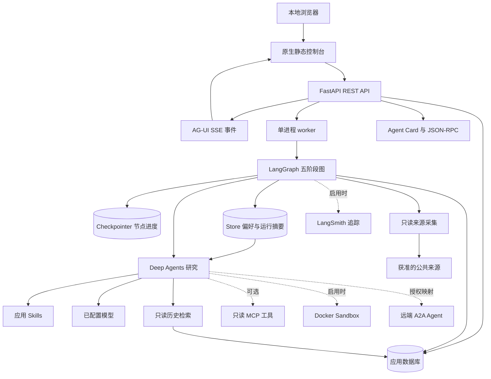
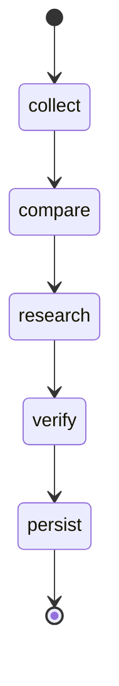
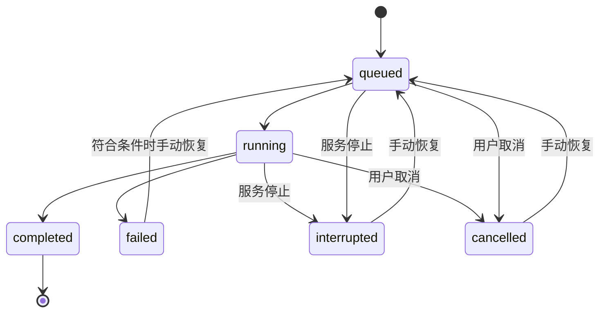
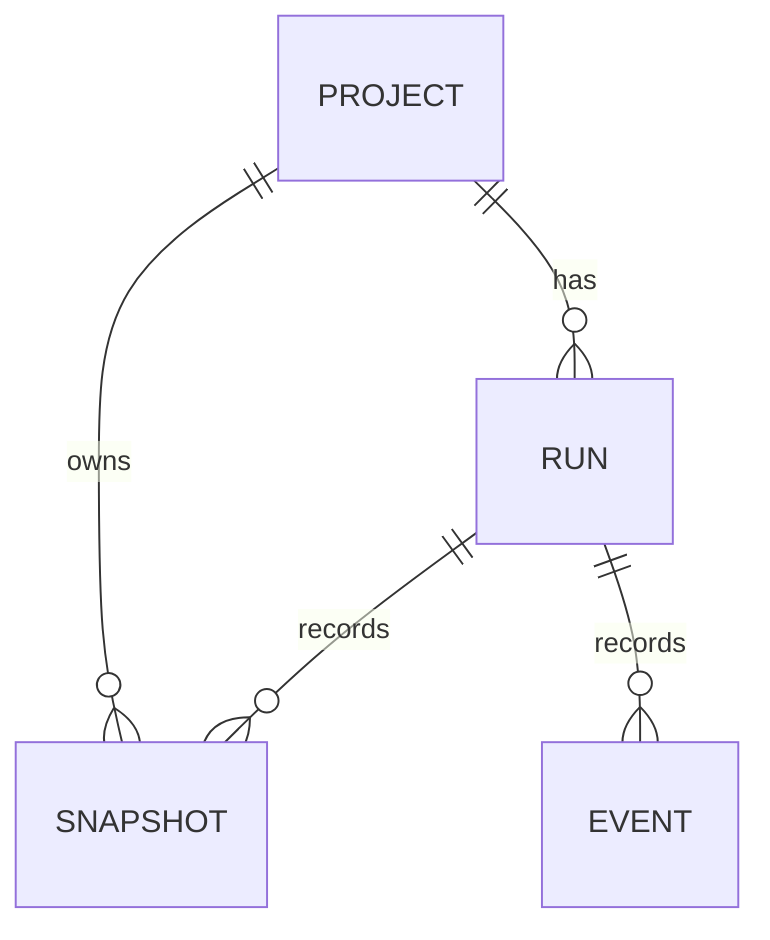

# SignalDesk 技术架构与接口

范围：当前 V0.4.7，沿用单用户、单进程执行架构。本文按仓库中的配置、SQLAlchemy 模型、Pydantic schema 和 HTTP 路由编写；Sandbox/A2A 基础见 [V0.4_UPGRADE.md](./V0.4_UPGRADE.md)，任务生命周期和请求体限额见 [V0.4.1_UPGRADE.md](./V0.4.1_UPGRADE.md)，扩展历史与旧库升级见 [V0.4.2_UPGRADE.md](./V0.4.2_UPGRADE.md)，采集和输入边界见 [V0.4.3_UPGRADE.md](./V0.4.3_UPGRADE.md)，状态和协议收尾见 [V0.4.4_UPGRADE.md](./V0.4.4_UPGRADE.md)。轻量运行历史与记忆范围见 [V0.4.5_UPGRADE.md](./V0.4.5_UPGRADE.md)，分批事件回放见 [V0.4.6_UPGRADE.md](./V0.4.6_UPGRADE.md)，本轮离线备份与恢复见 [V0.4.7_UPGRADE.md](./V0.4.7_UPGRADE.md)，最终运行验收记录在 [ROADMAP.md](./ROADMAP.md)。

## 1. 技术选择与边界

| 层 | 选择 | 职责 |
| --- | --- | --- |
| 接口与控制台 | FastAPI + 原生静态页面 | 输入校验、项目管理、手动运行、状态与报告展示 |
| 执行 | 单用户、单进程 worker | 从持久化运行记录处理任务；V0.1 不承诺分布式执行 |
| 工作流 | LangGraph | 固定五阶段状态图、检查点、受限手动恢复 |
| 模型能力 | LangChain + Deep Agents | 真实模型分析、应用 Skills；V0.1 提供 OpenAI 兼容服务适配 |
| 业务存储 | SQLAlchemy async | 默认 SQLite；正式环境使用 PostgreSQL |
| 执行存储 | SQLite / PostgreSQL checkpointer | 同一 `thread_id` 的图状态与恢复位置 |
| 工具互通 | 只读 MCP | 检索或读取明确允许的资料；协议连接不授予写操作权限 |
| 历史检索 | 全文 + 词法 + 可选 pgvector + Reranker | 项目与最新成功快照过滤，RRF 融合与重排 |
| 项目记忆 | LangGraph Store | 用户偏好与最近运行摘要，与检查点分开 |
| 前端交互 | AG-UI 标准事件 + SSE | 已有任务订阅、游标续传与断线重连 |
| 隔离执行 | Docker Python Sandbox | 有界代码/JSON输入、结果与清理；无宿主代码执行 |
| 跨 Agent 协作 | 官方 A2A SDK 1.2.2 | 协议1.0 JSON-RPC、0.3兼容、固定项目任务与白名单委托 |
| 观测与评测 | 日志、离线场景 + 可选 LangSmith | 确定性回归、显式实验上传与真实任务追踪 |

Deep Agents 是 LangChain / LangGraph 之上的 Agent harness。业务流程以显式图为准，research 节点按需调用 Deep Agent。当前依赖锁定 `langchain==1.4.7`、`langgraph==1.2.16`、`deepagents==0.7.30`、`fastapi==0.159.1`、`langchain-openai==1.7.2`、`ag-ui-protocol==1.0.0` 和 `langsmith==0.14.12`，完整可复现依赖见 `pyproject.toml` / `uv.lock`，这些是本项目选定版本，不是永远有效的“最新版”承诺。Python 范围为 3.11–3.14。V0.1 不引入完整分布式任务系统，也不将云端追踪作为离线演示的启动条件。

## 2. 组件视图



业务数据库与检查点数据库可以使用同一数据库服务，但必须区分访问方式与数据结构。应用查询不应直接依赖 checkpointer 内部表结构。

## 3. 图状态与节点契约



| 节点 | 主要输入 | 主要输出 | 关键约束 |
| --- | --- | --- | --- |
| collect | 项目、竞品、来源、模式 | 来源快照、采集时间、指纹、失败列表 | demo 只读内置夹具；live 的错误不得触发 demo |
| compare | 当前快照、历史基线 | 可复核变化候选、无变化/初始基线结果 | 抓取失败不等于删除；同一指纹不重复制造变化 |
| research | 变化候选、历史片段、Skills | 带引用的分析草稿与待核实问题 | 搜索与工具轮次受限；网页文本没有指令权限 |
| verify | 报告草稿与证据 | 通过引用一致性校验的报告或明确错误 | 检查标准 UTF-8/有限 JSON、证据 ID 唯一且原文包含 quote；不能证明事实真实或推断成立 |
| persist | 核验结果、运行标识 | 业务记录、报告、完成状态 | 同一运行重复执行要幂等，数据库事务与唯一键兜底 |

图状态在工作流模块中定义，保存运行、来源快照、变化、证据和报告所需数据。报告的 `findings[].citations[]` 包含 `evidence_id` 与 `quote`；校验“有引用”只是最低一致性检查，不代表引文支持全部 detail、资料本身正确或因果关系成立。大段来源正文与图状态的存储成本需要观测；未来可以用对象存储/文件引用替换大对象，但 V0.1 不因此引入未实现的存储依赖。

### 检查点与恢复

每个业务运行使用自己的图线程，不能将不同运行或不同项目共用一个固定 `thread_id`。运行 ID 用于 API，图线程和检查点由工作流管理；`RunRead` 不单独暴露 thread ID 字段。恢复 API 先检查业务状态与项目并发约束，再由执行器检查图检查点；执行器必须处理不存在检查点或图已完成等情况。

- **失败检查点**：如果图在节点异常前后保留了待执行任务，使用原 `thread_id` 继续；不重新构造一个与旧运行无关的图线程。
- **已完成运行**：不能把完成图的空恢复调用当作重新执行；新的采集应创建新业务运行。
- **进程中断**：启动时将遗留活动状态标为 interrupted，由用户手动恢复。存在待执行检查点时从检查点继续；没有有效检查点时使用原 run ID 重新进入图，collect 复用该运行已经保存的快照。图已经结束且检查点有报告时，可修复业务记录为 completed。当前不会自动调度续跑。
- **外部写入**：V0.1 工具只读；落库节点通过事务、唯一键或同等策略防重复，不能仅靠“节点通常只执行一次”。

检查点不保证任意外部操作“恰好一次”。未来引入通知、外部写操作或定时任务时，需要追加幂等键、发件箱或相应补偿设计。

当前恢复粒度是**顶层 LangGraph 节点级**。research 节点内新建的 Deep Agent 没有独立 checkpointer；中断发生在该节点内部时，恢复会重新进行这次模型/工具循环，可能产生额外模型成本。已经保存的 collect 快照会被复用，恢复不等于重新抓取最新网页；需要新资料时应创建新运行。

## 4. 运行状态模型

当前 `Status` 枚举为 `queued`、`running`、`interrupted`、`completed`、`failed`、`cancelled`：



运行记录区分 `status` 与当前 `stage`。`status=failed` 表示整个运行未完成；`stage=verify` 表示失败或当前执行的位置。服务启动时将遗留 `queued/running` 标记为 `interrupted`，等待用户恢复，不自动调度续跑。取消操作等待协程停止后再保存取消状态。错误向 API 返回通用摘要，事件记录错误类型；默认日志不输出可能包含请求头、密钥或私人来源正文的原始模型错误。

## 5. 实际数据模型

当前核心业务数据库定义 4 张表，V0.4 另有 3 张扩展表：sandbox_executions、a2a_requests、a2a_delegations。竞品在 V0.1 由来源的 `name` 表达，没有单独的 competitor 表；报告、发现与证据是 `runs.report` 内的结构化 JSON，没有独立 report、finding 或 evidence 表。

| 实体 | 逻辑字段 | 关系与约束 |
| --- | --- | --- |
| `projects` | `id/name/description/sources/focus/created_at` | sources、focus 为 JSON；来源 URL 在一个项目内不可重复 |
| `runs` | `id/project_id/mode/demo_revision/status/stage/error/report/created_at/updated_at` | 项目外键；report 为 JSON；部分唯一索引限制同一项目仅一个 queued/running |
| `snapshots` | `id/run_id/project_id/source_name/url/title/text/content_hash/created_at` | 来源原文与 hash；保存时验证运行和项目对应关系 |
| `events` | `id/run_id/kind/message/data/created_at` | 按自增事件 ID 读取增量进度；data 为 JSON |
| 图检查点 | `thread_id/checkpoint_id` 及图状态 | 独立 checkpointer 管理的内部表，不并入上述业务表 |
| `evidence_embeddings`（可选） | `snapshot_id/project_id/embedding` | 仅显式启用 pgvector 时由检索适配器创建，不是默认 SQLite 表 |



### 去重与一致性

`save_snapshot` 按快照 ID 合并写入，检查 ID 不跨项目/运行复用。`runs` 的部分唯一索引与应用锁保护项目活动运行约束；不同项目可在同一进程的有界并发池执行。项目锁按持有者和等待者计数，完成、异常或取消后回收，缺失项目 ID 不留下永久锁。历史比较只选择同项目、同来源 URL、已完成运行的最新快照，不以失败运行建立新基线。内容 hash 识别正文是否变化；每次运行仍可以留下快照和报告，当前不宣称具备跨运行“事件级去重账本”。

应用数据库会话在请求或短事务内创建，不能在单例 Agent 中跨并发任务复用 SQLAlchemy session。SQLite 用于本地单进程验证；PostgreSQL 用于正式运行路径。SQLite 服务在首次初始化前持有各库的本机协作锁，资源全部关闭后释放；仅共享一个库的实例也互斥。构造时冻结配置，三个适配器与锁使用同一规范路径。多 worker、跨主机所有权与迁移仍需单独实现。

`signaldesk-db` 提供本地 SQLite 三库离线备份、严格校验和新目录恢复；使用 SQLite backup API 保留 WAL 已提交内容，发布前校验完整性及哈希。恢复不覆盖现有库，不自动切配置；PostgreSQL 备份不在该命令范围内。协议只约束配合的服务与命令，外部写入者仍需停止。细节见 [V0.4.7_UPGRADE.md](./V0.4.7_UPGRADE.md)。

## 6. 模型、Skills 与工具边界

### 双模式协议

| 项目 | demo | live |
| --- | --- | --- |
| 资料 | Northstar / Orbit 内置夹具 | 允许的实际来源 |
| 模型调用 | 不需要密钥，不伪装真实模型分析 | Deep Agents + `openai:` 模型，支持兼容 base URL |
| 错误 | 夹具或内部流程错误可见 | 密钥、网络、模型与结构校验错误可见 |
| 结果标识 | 保存并展示 demo | 保存并展示 live |
| 降级策略 | 无 | 不能自动切换到 demo |

### Skills

应用从项目内 `skills/` 加载，或由 `SKILLS_DIR` 指向替代目录：

```text
skills/
├── competitor-analysis/SKILL.md
├── evidence-review/SKILL.md
└── report-writing/SKILL.md
```

每个目录只覆盖一种业务能力，遵循 Agent Skills 的 `name`、`description` frontmatter。`research.py` 将技能副本装入 Deep Agents 的 StateBackend 虚拟文件系统，仅向模型暴露副本，不把宿主项目目录和 `.env` 挂载给模型。Skills 定义分析过程和输出要求，不授予网络、宿主文件、密钥或外部系统权限。第三方文本不能覆盖 Skills；模型是否实际读取某个技能应通过真实调用轨迹确认，不能仅凭文件存在宣称完成验证。

真实报告采用 `ToolStrategy(ResearchReport)` 返回结构化结果。`read_evidence` 只能读取当前任务清单内的新旧证据；`search_history` 与外部 MCP 仅提供背景。最终引用只能指向本次 evidence manifest 中的 ID，不能引用仅从历史检索或外部 MCP 得到的清单外 ID。

### 只读工具与 MCP

独立 `signaldesk-mcp` 只暴露 `list_projects`、`get_report`、`search_evidence`，读取本应用数据库，不启动研究或模型调用。作为 MCP 客户端时，`MCP_URLS` 配合 `MCP_ALLOWED_TOOLS` 显式工具名称白名单；配置 URL 却不给白名单会在 live 研究时报错。白名单是管理员授权边界，不能自动证明被允许的远程工具实现只读；必须使用可信服务与只读凭据，不能仅凭工具的 readOnlyHint 跳过服务端权限。当前客户端使用 LangChain 原生 `MCPAdapter`；其接口的 Beta 变化需通过锁定依赖和回归管理。

所有网页、搜索结果、MCP 返回值、报告引用与历史记录都视为不可信数据。出现“忽略先前指令”“输出环境变量”等文本时只作为资料处理，不执行，不外发密钥。

## 7. 检索与记忆

检索仅返回当前项目、已完成运行、每个来源 URL 的最新快照，不将失败快照或其他项目混入结果。
词法基线在最近最多 1000 个候选内匹配；全文与向量路径直接按最新成功来源选择。

- PostgreSQL 使用 `to_tsvector('simple', ...)`、`websearch_to_tsquery`、`ts_rank_cd` 和 GIN 表达式索引；SQLite 使用 FTS5 与同步触发器，启动时补齐旧快照。
- `simple` 和 SQLite 默认分词器不提供专门中文分词。全文能力已验证，未做大数据量性能或中文相关性评测。
- 显式启用 pgvector 后，全部当前 live 快照统一检查缺失向量。复用其他运行要求同项目、同 URL、同正文 hash 且运行已完成；本次相同快照 ID 已落库的向量也可在报告保存失败后重试复用。未变化来源没有可复用向量时补齐，检索仍返回最新成功快照。这覆盖先关闭、后启用向量检索的项目，不负责嵌入模型或维度迁移。新正文没有向量时不能错误复用旧正文向量。
- 各召回通道按 RRF 融合，再由 `RERANKER_PROVIDER=none|lexical|http` 重排。默认 lexical 是确定性词法基线；http 使用 Cohere 风格请求与响应校验，可接模型服务。服务错误明确返回，不静默改用本地排序。
- `SearchHit` 返回 `retrieval_methods`、`retrieval_score`、`rerank_score` 和 `strategy`，便于区分实际执行的通道。
- 向量模式需要 PostgreSQL、嵌入模型/维度/密钥。demo 不生成向量；没有向量候选时不调用查询嵌入。未实现旧数据嵌入回填、ANN 调优或模型切换迁移。

### Checkpointer 与 Store 分工

Checkpointer 以运行 ID 为图线程保存节点状态。Store 以 `projects/<project_id>/preferences|runs` 命名空间保存跨运行记忆；SQLite 为实现 BaseStore 的持久化适配器，PostgreSQL 使用官方 AsyncPostgresStore。
同一个 Store 实例传给顶层图与 Deep Agent。HTTP API 只能读写项目偏好键，不能选择任意命名空间。

偏好只能由用户显式保存；系统仅自动写入运行摘要，记录 `citation_checked=true`、`facts_verified=false`。
collect 首次执行冻结当时的偏好与最近 5 条摘要，恢复复用原值。偏好变化会使相同来源重新研究；仅摘要或时间戳更新不会反复触发研究。运行摘要写入失败会留下警告，已保存的报告仍然有效。

默认每类最多 50 项，单个偏好键最多 80 字符、值最多 8KB。SQLite Store 不提供语义索引、TTL 或自动记忆整理；Store 中的文本是上下文数据，不是工具权限或系统指令。

## 8. 当前 HTTP API

路由位于 `src/signaldesk/api.py`。服务默认 `127.0.0.1:8000`，进度优先通过 AG-UI/SSE 订阅，带游标的 JSON 事件接口保留为兼容回退。配置 `API_TOKEN` 后，除健康检查外的 API 需要 `Authorization: Bearer <token>`；各业务和协议入口通过 `auth.py` 使用相同的 ASCII 字节常量时间比较，非 ASCII 凭据返回 401。这是一种共享 token 保护，不是多用户鉴权。

| 能力 | 方法与路由目标 | 请求/响应要点 |
| --- | --- | --- |
| 健康状态 | `GET /api/health` | status、version、mode、live_configured；只判断配置齐备，不发模型探测调用 |
| 能力状态 | `GET /api/capabilities` | 当前数据库/检索/Store/AG-UI 配置状态，不暴露连接串或密钥 |
| 列出项目 | `GET /api/projects` | 返回 ProjectRead 数组 |
| 创建项目 | `POST /api/projects` | name、description、sources、focus；成功 201 |
| 项目详情 | `GET /api/projects/{project_id}` | 项目不存在时返回 404 |
| 编辑项目 | `PUT /api/projects/{project_id}` | 全量 ProjectCreate；保留历史，活动任务期间返回 409 |
| 发起运行 | `POST /api/projects/{project_id}/runs` | `{mode: demo\|live, demo_revision: 1\|2}`；默认 demo/1，成功 202 |
| 运行历史分页 | `GET /api/projects/{project_id}/runs/page?limit=20&cursor=...` | items 为不含 report 的 RunSummaryRead；返回 next_cursor、has_more 和独立 active_run；limit 1–100 |
| 旧运行列表 | `GET /api/runs?project_id=...` | 保留兼容，project_id 可选；全量 RunRead 数组含 report，新控制台使用分页接口 |
| 运行状态与报告 | `GET /api/runs/{run_id}` | 返回 RunRead；报告保存在 report 字段，没有独立 /report 路由 |
| 导出报告 | `GET /api/runs/{run_id}/export?format=markdown\|json` | 完整的已完成报告作为附件下载；认证与其他业务 API 相同 |
| 事件分页 | `GET /api/runs/{run_id}/events/page?after=N&limit=100` | 安全事件 items、next_after、has_more、查询前采样的 producer_active；limit 1–200，空页保持 after；数据库读取最多 limit+1 条 |
| 旧增量事件 | `GET /api/runs/{run_id}/events?after=N` | 只返回此运行 id>N 的事件数组；after 范围为 0–2147483647 |
| AG-UI 事件流 | `GET /api/runs/{run_id}/ag-ui?after=N` | `text/event-stream`；Last-Event-ID 与 after 使用相同数据库游标范围，越界 422 |
| 项目记忆 | `GET /api/projects/{project_id}/memory?limit=10` | 明确偏好与最近运行摘要；有界扫描不能证明完整时返回 409 |
| 单项偏好 | `GET/PUT/DELETE /api/projects/{project_id}/memory/{key}` | PUT 接收 `{ "value": { ... } }`，DELETE 成功 204 |
| 手动恢复 | `POST /api/runs/{run_id}/resume` | interrupted/failed/cancelled 可申请恢复，成功 202；执行器继续检查图状态 |
| 取消运行 | `POST /api/runs/{run_id}/cancel` | 仅 queued/running 可取消；返回更新的 RunRead |
| 历史检索 | `GET /api/projects/{project_id}/search?q=...&limit=5` | q 长度 1–1000，limit 1–20；返回匹配证据或空数组 |
| 只读 MCP | 独立 `signaldesk-mcp` 命令 | 默认 stdio 服务，不是上述 HTTP API 下的一组写路由 |

错误语义：401 表示 token 缺失或不正确；404 表示资源不存在；422 表示输入或 live 配置不合法；409 表示项目有活动任务、恢复/取消状态冲突、报告不可导出或执行器正在关闭。请求恢复成功只表示加入队列，不能据 202 声称最终已经恢复完成。

`RunSummaryRead` 仅包含 `id/project_id/mode/demo_revision/status/stage/error/created_at/updated_at`，没有 `report` 字段，SQL 也不选择报告列。页序使用不可变的 `created_at DESC, id DESC`；游标绑定项目与 `runs` 类型。`active_run` 独立查询整个项目，不受分页位置影响，供活动观察和编辑/提交限制使用。详情继续通过已有 `GET /api/runs/{id}` 按需读取。

`runs` 增加 `(project_id, created_at DESC, id DESC)` 索引，初始化显式为已有表补建缺失索引，不修改原记录。启动恢复使用 `list_active_runs()` 的轻量摘要，不再通过旧 `list_runs()` 载入全部历史报告。

### AG-UI 事件契约

先 POST 创建业务运行，再订阅该运行。服务发送官方模型编码的 `RUN_STARTED`、`STATE_SNAPSHOT`、`STEP_STARTED/FINISHED`、`CUSTOM(name="signaldesk.event")`、`RUN_FINISHED` 或 `RUN_ERROR`。AG-UI 的 threadId 为项目 ID、runId 为业务运行 ID；图检查点线程仍是运行 ID。

只对业务日志 CUSTOM 事件附持久化 SSE id，重连用 `after` 或 Last-Event-ID 续传；初始状态快照可重复，前端按 ID 去重。事件按每批最多 100 条回放，仍有积压时让出事件循环并继续读取。终态事件等待本地任务完成 Store 与日志写入、并排空积压后发送，不以固定 250ms 推断写入完成。超过 2MB 的报告从快照省略，由 REST 获取。内部配置、记忆上下文、原始异常不投影到事件流。
JSON 回退每轮最多读取 3 页，has_more 或 producer_active 为真时继续续读，即使报告已保存也等生产任务的最终日志写入完成。控制台的事件数组和 DOM 仅保留最近 200 条，完整事件仍在服务端；窗口裁剪不回退确认游标。stream_unavailable 表示观察失败，需要重连，不能当作后台研究已失败。

断开订阅只停止观察；取消运行需显式调用 cancel。当前不是通用 `RunAgentInput` POST 端点，也没有聊天 token 流或人工审批事件。

### 请求与报告结构

创建演示项目示例：

```json
{
  "name": "SaaS 竞品观察（演示）",
  "description": "关注价格与产品更新",
  "sources": [
    {"name": "Northstar", "url": "https://northstar.example/pricing"},
    {"name": "Orbit", "url": "https://orbit.example/changelog"}
  ],
  "focus": ["pricing", "features"]
}
```

先运行 `{"mode":"demo","demo_revision":1}` 建立基线，完成后再运行 `{"mode":"demo","demo_revision":2}` 查看变化。夹具 v1/v2 是固定输入，不是模拟当前真实市场动态。

`RunRead` 字段为 `id/project_id/mode/demo_revision/status/stage/error/report/created_at/updated_at`。报告遵循以下结构：

| 字段 | 内容 |
| --- | --- |
| title、summary | 标题与摘要 |
| findings[] | title、detail、category、impact、citations[] |
| citations[] | evidence_id、quote；必须与 report.evidence 对应 |
| recommendations[]、limitations[] | 建议与覆盖限制；建议不代表已执行 |
| evidence[] | id、source_name、url、title、text、change_type、previous_id、diff、observed_at、is_previous |
| mode | demo 或 live |
| stats（V0.2 可选） | 来源总数、成功/失败数、基线/变化/一致数、model_call_skipped；旧报告允许缺省 |

`change_type` 为 baseline/changed/unchanged；`category` 为 pricing/features/positioning/other；`impact` 为 high/medium/low。当前 schema 没有每项结论的真假认证字段，不应自行发明“verified=true”并展示给用户。

## 9. 真实目录与职责

下列目录按当前仓库组织；后续新增模块以实际文件为准，运行数据与虚拟环境不计入源码树。

```text
signaldesk/
├── pyproject.toml              # 依赖和 CLI 入口
├── uv.lock                     # 锁定依赖
├── README.md
├── .env.example                # 环境变量模板
├── src/signaldesk/
│   ├── config.py               # 类型化设置与 live 配置检查
│   ├── schemas.py              # HTTP、报告与证据 schema
│   ├── db.py                   # 四张 SQLAlchemy 业务表
│   ├── repository.py           # 持久化、轻量运行分页、基线与词法查询
│   ├── api.py                  # HTTP 路由、token 与输入校验
│   ├── auth.py                 # 业务与协议共用的 Bearer 校验
│   ├── history.py              # 项目/类型绑定的 keyset 游标与分页封装
│   ├── exports.py              # Markdown/JSON 附件与完整性检查
│   ├── errors.py               # 安全错误码与处理建议
│   ├── jobs.py                 # 单进程有界任务池与取消/恢复状态
│   ├── collector.py            # 夹具、公共地址检查与有限 HTML 抓取
│   ├── local_storage.py        # 统一 SQLite 路径、配置冻结与本机文件锁
│   ├── backups.py              # 三库离线备份、严格校验与新目录恢复
│   ├── database_cli.py         # signaldesk-db 维护命令
│   ├── checkpoints.py          # SQLite / PostgreSQL checkpointer
│   ├── workflow.py             # 五阶段图与恢复逻辑
│   ├── research.py             # Deep Agents、Skills 与引用一致性
│   ├── retrieval.py            # 全文/词法/pgvector 召回与 RRF
│   ├── reranking.py            # none / lexical / HTTP 模型重排
│   ├── memory.py               # SQLite/PG Store、精确类别扫描与项目记忆
│   ├── memory_api.py           # 明确偏好 CRUD
│   ├── agui.py                 # 标准事件 SSE 投影与续传
│   ├── evaluation.py           # 固定夹具与 LangSmith 实验
│   ├── evaluation_cli.py       # signaldesk-eval 入口
│   ├── extensions.py           # run范围内的隔离计算/远端委托工具
│   ├── sandbox.py              # 容器生命周期、资源限制与执行持久化
│   ├── sandbox_api.py          # 项目范围执行/查询/取消
│   ├── a2a_server.py           # 官方协议1.0/0.3桥接与Card
│   ├── a2a_client.py           # 白名单客户端与本地委托API
│   ├── a2a_store.py            # 请求幂等与委托登记
│   ├── mcp_server.py           # 只读 stdio MCP 服务
│   ├── app.py                  # 应用组合与资源生命周期
│   ├── cli.py                  # 单进程 HTTP 启动入口
│   └── static/                 # 原生控制台 HTML / CSS / JavaScript
├── docs/
│   ├── PROJECT_PLAN.md
│   ├── ARCHITECTURE.md
│   ├── ROADMAP.md
│   ├── V0.2_UPGRADE.md          # 历史变更
│   ├── V0.3_UPGRADE.md          # 历史变更
│   ├── V0.4_UPGRADE.md          # Sandbox/A2A历史实现与验收
│   ├── V0.4.4_UPGRADE.md        # 状态、索引与协议收尾
│   ├── V0.4.5_UPGRADE.md        # 轻量运行历史与记忆范围
│   ├── SANDBOX.md              # Docker隔离配置与执行API
│   ├── A2A.md                  # 协议、Card、双实例接入
│   └── OPERATIONS.md            # 启动、配置与验证边界
├── skills/
│   ├── competitor-analysis/SKILL.md
│   ├── evidence-review/SKILL.md
│   └── report-writing/SKILL.md
├── evals/quality_cases.json     # 固定质量场景
├── tests/                      # 仓库、API、工作流与真实 PG 验证
├── .github/workflows/ci.yml     # 尚未在远端执行的 CI 配置
├── Dockerfile
└── compose.yaml                # 回环端口的本地 PostgreSQL/pgvector 路径
```

## 10. 配置、观测与部署约束

核心环境变量与含义：

| 环境变量 | 默认/约束 |
| --- | --- |
| `DATABASE_URL` | `sqlite+aiosqlite:///./data/signaldesk.db`；PostgreSQL 使用 asyncpg URL |
| `MEMORY_URL` | 默认 `sqlite:///./data/memory.db`；PG 使用 Psycopg URL |
| `MEMORY_MAX_ITEMS` | 默认 50，每个项目/类型的容量 |
| `ENABLE_FULLTEXT_SEARCH` | 默认 true，SQLite FTS5 / PG GIN |
| `RERANKER_PROVIDER` | 默认 lexical；http 另需 URL 和 model，可配置 API key |
| `CHECKPOINT_URL` | `sqlite:///./data/checkpoints.db`；PostgreSQL 使用普通 postgresql URL |
| `SANDBOX_ENABLED` | 默认 false；需本机 Docker 与固定镜像，具体限额见 SANDBOX.md |
| `ENABLE_A2A` | 默认 false；Card URL、远端 alias/token/project 映射见 A2A.md |
| `API_TOKEN` | 本机开发可空；外部服务必须设置并配 TLS |
| `RESEARCH_MODE` | demo；具体运行仍以 POST 的 mode 为准 |
| `MODEL`、`OPENAI_API_KEY` | live 必填；MODEL 使用 `openai:你的可用模型名` |
| `OPENAI_BASE_URL` | 可选 OpenAI 兼容服务地址 |
| `SKILLS_DIR` | 默认项目 skills/ |
| `MAX_CONCURRENT_RUNS` | 默认 2，限制 1–8；单进程并发，不是多 worker |
| `MAX_SOURCES` | 默认 8；项目 schema 本身也限制最多 8 个来源 |
| `MAX_SOURCE_BYTES`、`MAX_SOURCE_CHARS` | 默认 1000000 字节 / 24000 字符 |
| `REQUEST_TIMEOUT_SECONDS` | 默认 20 秒 |
| `AGENT_TIMEOUT_SECONDS`、`AGENT_RECURSION_LIMIT` | 默认 180 秒 / 24 |
| `MCP_URLS`、`MCP_ALLOWED_TOOLS` | 默认空数组；必须显式授权可信服务中的只读工具名称 |
| `ENABLE_VECTOR_SEARCH` | 默认 false；需要 PostgreSQL/pgvector 与嵌入配置 |
| `EMBEDDING_MODEL`、`EMBEDDING_DIMENSIONS` | 模型默认空，维度默认 1536；需与实际模型一致 |

追踪由 LangSmith 标准环境变量启用，例如 `LANGSMITH_TRACING`、`LANGSMITH_API_KEY` 与 `LANGSMITH_PROJECT`，具体示例见 `.env.example`。启动时应确认这些变量进入应用进程环境，文件中存在配置不等于云端 trace 已上传。live 配置检查不发网络请求，`live_configured=true` 只代表所需字段存在，不代表模型名、额度或服务地址可用。

CLI 会将 .env 配置加载到进程环境供 LangSmith 读取；独立嵌入应用时应由宿主加载环境。阶段事件包含 run ID 和 stage，错误日志记录 run ID 与异常类型。追踪可能包含用户输入和来源文本，上云前需要明确数据范围，敏感字段不得直接进入日志或提示词。记录模型使用量不等于实现硬预算中止，二者需分别验收。

V0.1 面向本机单用户运行。已有可选共享 token 与来源公共地址检查，仍不等于完整租户鉴权或网络出口防火墙；DNS 重绑定需要部署侧出口策略。对外部署必须设置 token、TLS 和访问限制，并继续补充限流、密钥管理、迁移、备份与审计，不能将“FastAPI 可启动”解释为“可直接提供生产 SaaS”。

## 11. 架构演进

1. 先保持 API、工作流和存储在一个服务中，验证业务闭环。
2. 来源和运行量增加后，拆分采集适配、事件指纹与历史检索策略。
3. 确认持续使用需求后，加入真正调度、通知、鉴权与多用户隔离。
4. 需要长时间并行研究时，再引入远端异步子 Agent 和事件通知；不以本地 `async` 调用冒充该能力。
5. 在当前 AG-UI、Sandbox 和 A2A 的实际业务数据上继续验证质量，再扩展通用 Agent 任务与专用执行节点。


## 12. V0.4 扩展契约

Sandbox 不是 Deep Agent 的宿主 shell backend，而是显式 `execute_python` 工具；代码仅在固定受限容器中执行。
A2A 服务桥接既有项目与 run，任务 ID 为远端 run ID；本地 delegation ID 是另一个持久 UUID。
两者都保留项目/run 归属与独立状态。容器结果和远端报告不能直接成为当前报告的合法证据。
顶层图与工具通过 ContextVar 绑定当前运行，避免并行项目之间串入运行上下文；入站 a2a_origin 禁止再次自动委托。

新增路由和原始协议样例见 [SANDBOX.md](./SANDBOX.md)、[A2A.md](./A2A.md)；完整运行接口以 OpenAPI 为准。

## 13. V0.4.2 历史与兼容升级

`history.py` 提供按项目与记录类型绑定的 keyset 游标。扩展历史新增 `GET /api/projects/{id}/sandbox/executions/page`、`GET /api/projects/{id}/a2a/delegations/page`，返回带 `items`、`next_cursor`、`has_more` 的有类型分页结构；每页默认20条、最多100条。新增项目范围的本地委托详情，远端不可用时仍可恢复保存的选择；旧数组接口继续保留。

`a2a_delegations` 增加可空 `created_at` 和历史索引；旧记录未知时间保留 NULL，不回填猜测时间。SQLite/PG 初始化以数据库锁串行进行增量兼容升级，保留原绑定与任务。控制台将列表分页请求、选中项和活动任务观察分开持有；数据查询和客户端展示的完整契约见本轮升级说明。
