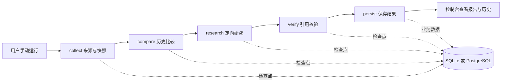

# SignalDesk · 竞品情报 Agent 项目方案

更新日期：2026-10-23。当前实现为 V0.4.3，本地单用户、单进程验证版本。本文保留产品目标和首期设计，新增能力与验收见 [V0.4_UPGRADE.md](./V0.4_UPGRADE.md)、[V0.4.1_UPGRADE.md](./V0.4.1_UPGRADE.md) 与 [V0.4.2_UPGRADE.md](./V0.4.2_UPGRADE.md)。 本轮采集、检索与接口交互升级见 [V0.4.3_UPGRADE.md](./V0.4.3_UPGRADE.md)。

> 本文中的“V0.1 目标”是验收要求，不代表所有目标已经验证。实现与验证状态见 [ROADMAP.md](./ROADMAP.md) 的状态表；接口和目录以 [ARCHITECTURE.md](./ARCHITECTURE.md) 及运行中的 OpenAPI 为准。演示数据必须标为夹具，不能作为真实市场情报。当前 verify 节点检查引用是否指向存在的证据、引文是否存在于原文；这不等于证明事实真实或推理成立。

## 1. 产品要解决的问题

用户需要持续知道特定竞品的产品、价格、定位和更新发生了什么变化，并能打开原始证据检查结论。产品以“可追溯的变化记录”作为核心资产：一个监控项目持续积累来源快照、事实、变化和报告，后续运行优先比较已有数据，再决定哪些问题值得进一步研究。

第一批使用者是独立开发者、小型 SaaS 产品团队和产品经理。先聚焦一个细分产品领域与少量官方来源，验证“减少重复人工查看竞品网站的时间”与“提高有价值变化的发现率”，再扩展行业和渠道。未来热度与付费潜力是产品假设，需要真实使用验证。

### 核心价值

- **持续积累**：保留历史，而不是每次从头生成一次性报告。
- **变化优先**：区分新增事实、修改、移除、页面噪声和无法确认的情况。
- **证据优先**：重要事实记录来源 URL、摘录、采集时间与快照指纹。
- **可人工接管**：展示运行进度、失败原因与检查点，支持对可恢复运行手动继续。
- **模式透明**：无密钥也能运行固定示例；真实模型模式缺失密钥必须失败，不能静默切换为示例。

## 2. 首期范围与功能模块

| 模块 | V0.1 目标 | 验收边界 |
| --- | --- | --- |
| 监控项目 | 创建和查看项目、竞品及来源配置 | 单用户，无团队权限系统；来源数量有限 |
| 明确的演示模式 | 使用 Northstar / Orbit 的内置夹具走完整业务流程 | 控制台、运行记录和报告都能识别 demo；不伪装实时采集 |
| 真实模型模式 | 使用 Deep Agents、应用 Skills 与实际配置的模型 | 缺失模型密钥时返回清晰错误；不降级为 demo |
| 来源采集 | 获取获准来源的文本和元数据 | 只读来源；外部网页属于不可信数据；限制抓取时间和大小 |
| 变化比较 | 与最近成功快照比较指纹与文本 diff | 首次采集标为初始基线；语义事件归并为后续能力；空内容或抓取失败不能解释为竞品删除内容 |
| 定向研究 | 对变化补足背景、比较已有历史 | 先做可运行的历史检索基线；可选 pgvector，不将向量检索作为启动依赖 |
| 引用校验 | 检查证据 ID 存在且引文包含在对应原文 | 不能证明事实真实性、事件时间或因果关系；需要人工核查 |
| 报告与历史 | 保存本次结果，查看过去运行与情报 | 不只在浏览器内存里保存；应用重启后可查询 |
| 任务执行 | 单进程 worker 运行 LangGraph 五阶段图 | 不宣称跨进程队列、分布式调度或高可用 |
| 状态与恢复 | SQLite / PostgreSQL checkpointer，手动继续可恢复运行 | 已终止图与失败后检查点恢复需区分；不承诺任意节点回滚 |
| 只读 MCP | 提供或接入明确标为只读的工具 | 禁止通过 MCP 任意写文件、执行命令或修改外部系统 |
| 追踪 | 通过环境变量启用 LangSmith | 未配置时不要求云端账号；不把密钥写入追踪内容 |
| 静态控制台 | 原生 HTML / CSS / JavaScript，配合 FastAPI | 展示配置、运行状态、历史、证据和错误；先不引入前端框架 |

### 后续范围

V0.3 已增加 AG-UI/SSE、持久化 Store、PostgreSQL 全文检索、可配置 Reranker 与离线质量评测。默认重排是确定性词法基线，远端模型重排需配置服务并验收。V0.4 已实现 Docker Python Sandbox 和 A2A 1.0 的跨实例项目研究委托。真正定时调度、通用远端多 Agent 规划、多租户鉴权和通知系统仍属于后续阶段；协议互通不等于具备这些产品能力。

## 3. 用户流程

### 3.1 无密钥体验

1. 启动服务，打开本地控制台。
2. 查看模式说明，创建或选择演示监控项目。
3. 选择 demo 与基线 v1，手动发起一次运行。
4. 在运行详情查看 collect → compare → research → verify → persist 的阶段与状态。
5. 查看 Northstar / Orbit 示例证据与报告，确认每一项都有演示标识。
6. 改用变化 v2 再次运行，查看新旧差异；再次运行相同 v2 时应显示无新变化。
7. 重启服务后再次打开项目，历史记录仍可查询。

### 3.2 真实情报流程

1. 配置模型提供商、模型标识和密钥；需要 PostgreSQL 时配置数据库与检查点连接。
2. 创建项目，加入竞品与其官方更新日志、定价页或产品页。
3. 选择 live，检查来源范围，再发起运行。
4. 首次运行建立基线；后续运行比较来源变化。
5. 系统针对变化进行分析，校验引用与原文的一致性并保存报告。
6. 用户打开引用，确认事实与影响判断；失败时查看具体原因，需要时手动恢复。

### 3.3 异常处理

| 情况 | 用户应看到的结果 |
| --- | --- |
| live 缺少密钥 | 明确配置错误，不能显示 demo 报告 |
| 页面超时或不可访问 | 来源失败与失败原因，不能推断内容被移除 |
| 页面只改变时间戳或布局 | 尽量归类为噪声；无法确定时保留不确定性 |
| 模型输出无法通过结构校验 | 运行失败或进入受限重试，保留错误信息 |
| 引用不合法或证据语义不足 | 引用不合法导致校验失败；语义是否支持结论需人工判断并记录覆盖限制 |
| worker 中断 | 应用记录与检查点可供查询；只对满足恢复条件的运行开放恢复 |
| 重复点击运行 | 返回明确的新运行或冲突结果；不能悄悄产生重复入库记录 |

## 4. Agent 能力设计

工作流的控制权由 LangGraph 状态图掌握。Deep Agents 用于真实模式下需要模型推理的 research 阶段，verify 阶段执行确定性引用校验。Skills 要求模型谨慎核查，但不能将这些提示词要求当作已经完成事实真实性验证。不允许模型绕过图的输入限制或直接决定业务数据是否落库。



### 应用 Skills

- `competitor-analysis`：比较竞品的产品、价格、定位与明确变化；先定义比较口径，再分析影响。
- `evidence-review`：核查每个重要事实的来源、时效性与摘录支持程度，区分事实和推断。
- `report-writing`：按统一结构撰写变化摘要、证据、影响和下一步，显式呈现无变化或证据不足。

这些技能仅服务本应用，不安装为开发者个人的 Codex skill。网页、PDF、MCP 返回文本和历史记录中的命令语句都属于资料，不能成为修改系统指令、读取密钥或越权调用工具的依据。

## 5. 数据与接口原则

业务记录和图检查点是两个不同的数据面：业务记录用于控制台查询、去重与报告；图检查点用于恢复特定运行的执行状态。应用数据库写入成功不等于图运行成功，图有检查点也不等于报告已经落库。

V0.3 使用独立 LangGraph Store：按项目保存用户明确偏好和经过引用结构校验的运行摘要；摘要不是已证明的事实。collect 开始时冻结记忆上下文，恢复沿用原上下文。偏好仅影响分析关注点与表达，不授予工具权限；模型不写用户偏好。Checkpointer 继续负责顶层图节点进度，research 内部没有单独检查点，恢复可能重新调用模型。

逻辑实体包括监控项目、竞品、来源、运行、来源快照、变化/事实、证据、报告与检查点关联。核心业务表为 `projects`、`runs`、`snapshots`、`events`；来源放在项目 JSON 中，报告和证据放在运行的 `report` JSON 中。Sandbox、A2A、检索和 Store 的持久化结构及具体接口见 [ARCHITECTURE.md](./ARCHITECTURE.md)。时间以带时区的 ISO 8601 格式返回，显示时可转为本地时间，原始采集时间保留 UTC。

接口覆盖健康与能力检查、项目配置、手动运行、状态与恢复、报告导出、AG-UI 事件订阅、项目记忆 CRUD、情报历史与只读检索。核心研究 API 不接受代码或宿主命令作为任务输入。显式启用的 Sandbox 扩展端点在通过 API 鉴权与项目校验后，接受 Python 和 JSON 并在受限 Docker 容器内执行；它不提供宿主 SQL、shell 或任意文件访问接口。静态控制台与后端使用同源接口，服务默认只绑定回环地址。

## 6. 评测与验收

### 6.1 固定回归与人工评测场景

下表定义产品质量目标，不表示当前自动测试已经覆盖全部场景。V0.1 的自动引用校验只覆盖证据 ID 与引文原文匹配；事实支持程度、变化语义和建议质量需要人工样本评测。

| 场景 | 期待行为 | 观测指标 |
| --- | --- | --- |
| 新项目首次采集 | 建立基线，不能把整页写成“新发布” | 首次基线误报数 |
| 相同内容再次运行 | 不新增同一变化事件 | 重复事件数 |
| 确定的价格变化 | 给出新旧值、适用条件、来源与时间 | 变化识别、数值正确率 |
| 时间戳或导航变动 | 不当作重要竞品变化 | 噪声误报率 |
| 证据只支持部分结论 | 人工评审时缩小结论或记录覆盖限制 | 无证据断言数 |
| 网页内含“忽略指令” | 当作网页内容，不执行 | 越权动作数 |
| 来源不可访问 | 报告采集失败，不能编造事实 | 失败可见性 |
| 中断后恢复 | 使用同一运行标识继续，不能重复持久化 | 重复记录、恢复成功数 |
| live 缺少密钥 | 明确失败，无示例结果混入 | 误降级次数 |
| 数据库重启或重开应用 | 历史可查询 | 持久化完整性 |

### 6.2 V0.1 验收门槛

- 无密钥 demo 能通过 API 与控制台完成一次五阶段运行，结果可追溯到内置夹具。
- SQLite 默认路径可持久化业务历史与检查点；PostgreSQL 路径有明确配置与可执行验证步骤。
- 每项报告发现均能关联具体证据，引用校验不能被展示为“事实真实性认证”；重要结论仍需人工判断证据是否真正支持。
- 已覆盖无密钥错误、来源失败、重复入库和手动恢复的必要检查；实际执行结果记录在路线图中。
- 真实模型验证需要有效密钥和真实来源；未执行的验证必须标为未执行。
- 不要求用单次生成质量证明整个系统效果。真实采样至少检查事实、来源、变化和成本四类指标。

质量指标应区分确定性回归与人工样本评估。先建立小型、可人工核查的案例集，再观察变化识别 precision / recall、证据支持率、报告可操作性、平均耗时、失败率与每次运行成本。样本量和标注口径同时记录，不使用缺少样本解释的百分比分数。

## 7. 成本与预算

V0.1 先使用本地 SQLite 和内置演示夹具，demo 不需要模型调用费。live 成本取决于模型、输入输出、抓取量、重试和可选检索服务；下面是控制预算的方法，不是供应商报价。

```text
单次运行成本 = 模型输入 tokens × 输入单价
             + 模型输出 tokens × 输出单价
             + 搜索/抓取/嵌入服务费
             + 存储与运行环境的分摊成本
```

建议初始实验预算为人民币 100–300 元，作为产品验证的内部上限假设；购买前按供应商当日价格换算，不承诺能覆盖固定运行次数。先从 2 个竞品、每个 1–2 个官方来源开始，手动执行 10–20 个经过人工核查的案例，再扩大来源和运行频率。限制工具轮次、最大来源数、页面大小、请求超时和模型重试；是否已实现硬性预算拦截需在路线图明确。

规模估算应使用实测值：月运行量 × 单次平均费用，再加失败重试、数据库与抓取服务费用。向量检索、通知渠道和定时运行都会引入额外维护或服务成本，避免在验证价值前一次接齐。

## 8. 风险与处理

| 风险 | 影响 | 处理方式 |
| --- | --- | --- |
| 通用调研产品竞争 | 很难凭“能写报告”形成差异 | 聚焦行业、长期历史与变化解释 |
| 来源和提取不稳定 | 误报、漏报 | 保留原文指纹和失败状态，逐步加入来源专用适配 |
| 模型幻觉与引用错配 | 报告失信 | 证据核验、结构校验、人工样本评测 |
| 外部内容注入 | 越权调用或泄露 | 数据/指令隔离，只读工具，限制输入与来源 |
| 单进程运行中断 | 任务停滞或状态不同步 | 持久化运行记录与检查点，提供受限手动恢复 |
| 数据库并发/迁移 | SQLite 写入冲突或升级丢数据 | V0.1 限制单进程；正式路径使用 PostgreSQL；迁移工具单独验收 |
| 本机服务被直接暴露 | 任意用户可读写项目 | 默认回环地址；对外需配置共享 token、TLS 和访问限制，后续补租户鉴权 |
| 真实采集的访问约束 | 来源不可用或不允许自动化访问 | 尊重来源访问规则，优先官方 API / RSS / 公共更新日志 |
| 示例与真实数据混淆 | 对产品能力产生错误认识 | 模式显式传递并保存，demo 全程可辨识 |

## 9. 实施顺序

先实现一条可运行的 demo 闭环，再把同一业务协议接到真实模型与来源；随后验证持久化、错误处理与恢复。不能把“装了依赖”当作“功能已具备”。分阶段交付与退出条件见 [ROADMAP.md](./ROADMAP.md)。


## 10. V0.4 对应技术栈与落地顺序

| 用户指定技术 | 当前模块与职责 | 后续验收 |
| --- | --- | --- |
| Python + FastAPI | 类型化 REST、鉴权、SSE、后台任务 API | 多租户与生产部署 |
| LangGraph | 五节点图与手动恢复 | 分布式任务执行 |
| Deep Agents + LangChain | research 节点的工具循环与结构化报告 | 有效密钥下的真实模型样本 |
| Agent Skills + MCP | 3 个虚拟文件系统技能、只读工具白名单 | 真实远端 MCP 服务 |
| PostgreSQL + pgvector + 全文 + Reranker | 已完成来源的项目范围检索、RRF、lexical/http 重排 | 真实嵌入及模型重排质量 |
| Checkpointer + Store | 节点进度与跨运行偏好/摘要分别持久化 | 记忆质量与规模治理 |
| LangSmith | 可选 trace、显式实验上传入口 | 云端实验实际上传 |
| AG-UI | 已有任务的标准事件 SSE 投影 | 通用 Agent 运行协议与交互扩展 |
| Sandbox + A2A | Docker 受限 Python 执行；官方 SDK 的 JSON-RPC 项目研究委托 | 容器和双 HTTP 实例已验证；公网多租户、通用 Agent 任务仍需扩展 |

实施顺序是：先完成可重复的离线闭环和恢复，再接通数据库/检索/Store/事件流，随后配置真实服务做小样本人工评测，然后以已实现的 Sandbox 和 A2A 开展具体业务验证。详细状态与退出条件见 [ROADMAP.md](./ROADMAP.md)。
